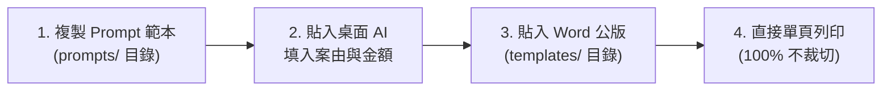

# 🏫 重溪國小教育捐助與對焦信函 AI 協同工具包 (Chongxi Charity Fundraising AI Toolkit)

> 本儲存庫為臺南市柳營區重溪國民小學（及在地夥伴社團法人臺灣璞育文教發展協會）向民間企業、慈善事業基金會爭取教育助學、課後照顧、營養晚餐與軟硬體改善經費之**標準化信函產出、AI 提示詞庫、防裁切公版範本與專案管理知識庫**。

---

## 🌟 核心理念與特色

1. **教育情懷（私人正式信函體）**：擺脫冷硬公文八股，以深具教育溫度的書信，真誠向社會賢達呈報辦學成果與孩子成長。
2. **教育尊嚴（絕對去標籤化）**：全篇堅持使用「鄉村地區」、「鄉下農村」，**絕對嚴禁使用「偏鄉」標籤**，守護孩子自信。
3. **主體分明（學校 vs 協會嚴防混淆）**：精準區隔學校校內課輔（農會公庫）與璞育社區供餐（中信帳戶），帳務合規透明。
4. **一頁極簡與防裁切美學**：經辦公室實體印表機嚴格實測，獨家配置 **16mm 安全列印區與 3.5cm 頂端邊界**，吉祥物羽冠不裁切、字體不斷行、全文完美單頁收納。

---

## 🚀 同仁桌上 AI 快速使用指引（三步驟）

學校同仁無須學習程式或 Git 指令，只要利用電腦桌面的 **ChatGPT、Google Gemini、Microsoft Copilot 或 Claude**：



1. **第一步：複製提示詞** ➔ 打開 [`prompts/00_同仁桌上AI一鍵使用手冊.md`](prompts/00_同仁桌上AI一鍵使用手冊.md)，複製通用範本並修改受文單位與金額。
2. **第二步：發送給 AI** ➔ 貼到桌面的 ChatGPT / Gemini / Copilot 視窗，10 秒產出優雅溫暖的信函草稿。
3. **第三步：貼入公版排版** ➔ 下載並打開 [`templates/重溪國小_正式信函公版_防裁切標準格式.docx`](templates/重溪國小_正式信函公版_防裁切標準格式.docx)，直接貼上內文，完美單頁印出！

---

## 📂 儲存庫結構 (Repository Structure)

```
├── README.md                                  # 儲存庫首頁與使用導引
├── AGENTS.md                                  # 給 AI Coding Agent（如 AntiGravity）遵循的專案規則
├── handoff.md                                 # 專案進度交接與最新版本工作紀錄
├── prompts/                                   # 同仁桌上 AI 專用提詞庫
│   ├── 00_同仁桌上AI一鍵使用手冊.md           # 3 步驟圖文教學
│   └── 03_客製化GPT或Gemini_Gem設定指令.md    # 建立校內專屬 AI 助理指令
├── templates/                                 # 實體列印防裁切標準公版
│   ├── 重溪國小_正式信函公版_防裁切標準格式.docx  # Word 範本（已內建 LOGO、校徽與 3.5cm 邊界）
│   └── 重溪國小_正式信函公版_防裁切標準格式.pdf   # 視覺對照 PDF
├── docs/                                      # 行政手冊與行政指引
│   └── 同仁實務操作手冊_避坑與帳戶指南.md       # 帳戶、時程管制與五大禁忌
├── output/                                    # 歷次正式產出信函（版本控管）
│   ├── 20261123_吳修齊基金會_重溪國小感謝信_v4.docx # 116年吳修齊獎 40.4 萬核定感謝信 (正式版)
│   └── 20261123_吳修齊基金會_重溪國小感謝信_v4.pdf  # 完美單頁直接列印 PDF
└── scripts/                                   # Python 自動化排版與轉檔輔助腳本
```

---

## 🏦 核心金融帳戶速查（嚴防混淆）

| 單位名稱 | 金融機構名稱 | 戶名 | 帳號 | 用途 |
| :--- | :--- | :--- | :--- | :--- |
| **重溪國小** | 臺南市柳營區農會 | 臺南市柳營區重溪國民小學代收款專戶 | **`0009216 0094086`** | 校內課輔班、公庫代收款 |
| **璞育協會** | 822 中國信託商業銀行 | 社團法人臺灣璞育文教發展協會 | **`148540274009`** | 社區課照班、學童晚餐伙食費 |

---

## 📅 重要基金會案件管制時程

- **財團法人吳修齊紀念雙親文教公益基金會**：
  - 116 年「吳修齊獎」課後輔導計畫核定補助 **404,890 元**。
  - **116 年 1 月**：開立第一期款 70%（283,423 元）領據，檢附柳營區農會公庫存摺封面影本函復。
  - **116 年 9 月 15 日前**：繳交「116 年中期成果報告」，撥付第二期款 30%（121,467 元）。
- **財團法人台南市私立光洋社會福利慈善事業基金會**：
  - 學校端：清寒助學金調整為低年級課照費用。
  - 璞育協會端：全年度 170 天、16 位學童晚餐伙食費差額補助（17 萬 2,000 元）。

---

## 👨‍🏫 專案主持人與維護單位

- **學校**：臺南市柳營區重溪國民小學
- **地址**：73656 臺南市柳營區義士路二段 2 號
- **電話**：(06) 623-1824 | **傳真**：(06) 623-0725
- **負責人**：校長 吳建邦
