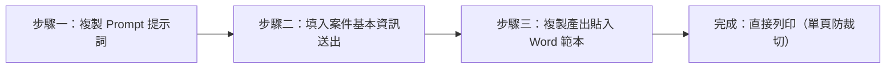

# 🏫 重溪國小教育捐助與公私信函 AI 助手 — 同仁桌上使用指南

> **適用對象**：全體行政處室同仁（教導處、總務處、校長室、幼兒園）及在地合作夥伴  
> **適用 AI 工具**：同仁電腦桌面或瀏覽器開啟的 **ChatGPT**、**Google Gemini**、**Microsoft Copilot**（Windows/Edge 內建）或 **Claude**。

---

## ⚡ 三分鐘極速上手流程（3 步驟完成一封信）



### 步驟一：打開您電腦上的任一 AI 視窗
無論是免費版或付費版的 **ChatGPT**、**Google Gemini**、Edge 瀏覽器右側的 **Copilot**，皆可直接使用。

### 步驟二：複製下方的「萬能信函生成提示詞」，填入案件資料並送出
請複製下方引號內的提示詞，並修改 `【 】` 內的內容後發送給 AI：

```markdown
我是臺南市柳營區重溪國民小學的行政同仁，請協助我撰寫一封由「重溪國小 校長 吳建邦」具名的正式感謝或申請信函。

【本次案件基本資訊】：
- 受文對象：【例如：財團法人台南市私立光洋社會福利慈善事業基金會 蘇董事長與全體董監事】
- 計畫/案由名稱：【例如：116 年低年級課後輔導計畫補助】
- 核定/申請金額：【例如：新臺幣 404,890 元整】
- 檢附文件說明：【例如：已附第一期款領據、柳營區農會公庫存摺封面影本、2027年桌曆】

【四大嚴格撰寫規範（絕對遵守）】：
1. 體例風格：採用深具教育情懷與溫度的「私人正式信函體」，絕不可寫成「主旨、說明、辦法」等冷硬公文格式。
2. 去標籤化禁忌：本校座落於農村，請客觀使用「鄉村地區」、「鄉下農村」，【絕對嚴禁使用『偏鄉』二字】，展現學校教育的主體性與自信。
3. 帳戶資訊：如需提及學校受款帳戶，請精準載明「柳營區農會代收款專戶（帳號：0009216 0094086）已詳載於領據中」，切勿自行提及歷年公庫結餘款。
4. 長度控管：全文篇幅約 400~500 字，結構包含：抬頭敬稱、展信安好、第一段（由衷感謝與核定背景）、第二段（學校環境與學童受惠實況）、第三段（專款專用與深耕承諾）、第四段（附件領據說明）、祝福語與署名。
```

### 步驟三：將 AI 生成的內文貼入公版 Word 檔
1. 下載並打開本專案提供的公版：[`templates/重溪國小_正式信函公版_防裁切標準格式.docx`](../templates/重溪國小_正式信函公版_防裁切標準格式.docx)。
2. 將 AI 產出的 4 個段落文字複製貼上，覆蓋範本中的提示框。
3. 檔案已預設好：
   - ✅ 頁首吉祥物圖標距頂端 16 mm（安全避開印表機 5~10mm 滾輪裁切區）。
   - ✅ 頂端邊界 3.5 cm，抬頭稱謂與圖標留有舒適留白。
   - ✅ 頁尾已置入五瓣校徽、學校電話地址、校長專屬 LINE QR Code。
   - ✅ 嚴格控制為 **完美單頁（1 頁極簡）**，直接印出即可呈核發文！

---

## 💡 常見問題與避坑提示

1. **Q：如果款項是要給「璞育協會」的課後照顧晚餐，帳號也是農會嗎？**
   - **答：絕對不是！**
   - 學校課輔經費 ➔ **柳營區農會代收款專戶**（`0009216 0094086`）。
   - 璞育協會晚餐伙食費 ➔ **中國信託商業銀行 (822)**（`148540274009`，戶名：社團法人臺灣璞育文教發展協會）。
   - 兩者時段、性質不同，絕不能混淆！

2. **Q：為什麼信件裡不能寫「偏鄉」？**
   - 吳校長與學校堅持教育主體性：柳營重溪的孩子充滿生命力，我們要呈現的是「鄉村教育的深耕與活力」，而不是向社會大眾「兜售悲情與弱勢標籤」。

3. **Q：印表機印出來上面被切掉怎麼辦？**
   - 請直接使用 `templates/` 資料夾內的公版，切勿手動將邊界調小於 3.5 cm，以確保任何型號印表機都能完整印出吉祥物與標題。
